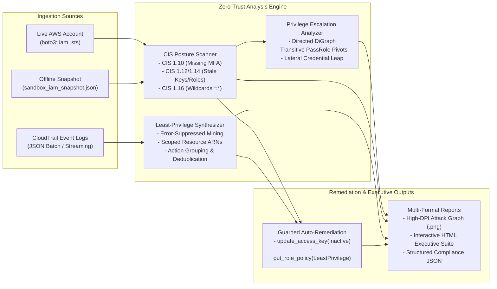
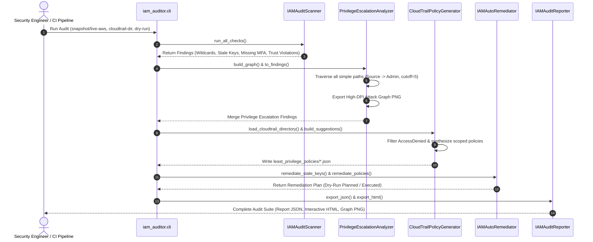
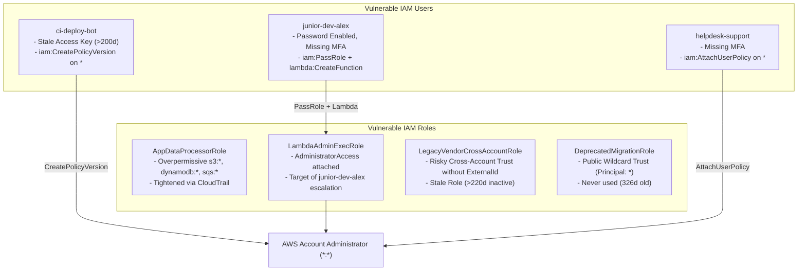

# AWS IAM Posture Auditor & Least-Privilege Policy Generator

<div align="center">

[](https://www.python.org/)
[](https://aws.amazon.com/sdk-for-python/)
[](https://networkx.org/)
[](https://www.cisecurity.org/benchmark/amazon_web_services)
[](https://attack.mitre.org/matrices/enterprise/cloud/)
[-brightgreen?style=for-the-badge&logo=pytest&logoColor=white)](https://pytest.org/)

<p align="center">
  <b>Enterprise-grade AWS Cloud Security Posture Management (CSPM), Graph-Theoretic Privilege Escalation Detection, CloudTrail Least-Privilege Synthesis, and Guarded Auto-Remediation Engine.</b>
</p>

</div>

---

## Table of Contents
- [1. Architectural Overview](#1-architectural-overview)
- [2. Core Capabilities](#2-core-capabilities)
  - [2.1 IAM Posture & CIS Benchmark Scanner](#21-iam-posture--cis-benchmark-scanner)
  - [2.2 Graph-Theoretic Privilege Escalation Analyzer (NetworkX)](#22-graph-theoretic-privilege-escalation-analyzer-networkx)
  - [2.3 CloudTrail Telemetry Mining & Least-Privilege Synthesizer](#23-cloudtrail-telemetry-mining--least-privilege-synthesizer)
  - [2.4 Deterministic Auto-Remediation (Dry-Run by Default)](#24-deterministic-auto-remediation-dry-run-by-default)
  - [2.5 Publication-Grade Executive & Technical Reporting](#25-publication-grade-executive--technical-reporting)
- [3. System Architecture & Pipeline Data Flow](#3-system-architecture--pipeline-data-flow)
- [4. Attack Vectors & MITRE ATT&CK Cloud Matrix](#4-attack-vectors--mitre-attck-cloud-matrix)
- [5. Project Layout](#5-project-layout)
- [6. Installation & Prerequisites](#6-installation--prerequisites)
- [7. Quick Start & CLI Reference](#7-quick-start--cli-reference)
  - [Mode A: Running Against the Bundled Sandbox Snapshot](#mode-a-running-against-the-bundled-sandbox-snapshot)
  - [Mode B: Running Against a Live AWS Account via Boto3](#mode-b-running-against-a-live-aws-account-via-boto3)
  - [Mode C: Executing Live Auto-Remediation](#mode-c-executing-live-auto-remediation)
- [8. Deliberately Misconfigured Terraform Sandbox](#8-deliberately-misconfigured-terraform-sandbox)
- [9. Programmatic Python API](#9-programmatic-python-api)
- [10. Test Suite & Verification](#10-test-suite--verification)
- [11. Documentation Links](#11-documentation-links)
- [12. License](#12-license)

---

## 1. Architectural Overview

The **AWS IAM Auditor** is designed to eliminate identity attack surfaces in complex, multi-account AWS environments. Rather than relying on superficial heuristic rules, the platform models IAM entities and transitive permissions as a mathematical directed multigraph $G = (V, E)$, traverses multi-hop privilege escalation chains to administrative access (`*:*`), mines historical AWS CloudTrail audit logs to generate mathematically bounded least-privilege policies, and automates credential deactivation behind strict dry-run guards.



---

## 2. Core Capabilities

### 2.1 IAM Posture & CIS Benchmark Scanner
The scanner module ([`iam_auditor/scanner.py`](file:///iam_auditor/scanner.py)) audits all active IAM users, customer-managed policies, attached AWS-managed policies, and assume-role trust policies against industry standards:
- **Wildcard Policy Detection (`*:*`, `<service>:*`)**: Flagging administrative wildcards across customer-managed and inline policies (CIS AWS Foundations Benchmark 1.16).
- **Dormant Credentials & Stale Access Keys**: Identifying active `AKIA...` keys unused or unrotated beyond configurable thresholds (`--stale-days 90`, CIS AWS 1.12 / 1.14).
- **Console Users Without Multi-Factor Authentication (MFA)**: Pinpointing IAM identities with active login profiles that lack virtual or hardware MFA tokens (CIS AWS 1.10).
- **Risky AssumeRole Trust Policies (Confused Deputy Guard)**: Flagging trust policies with public wildcard principals (`"Principal": "*"`) or cross-account trusts lacking `sts:ExternalId` and `aws:MultiFactorAuthPresent` conditions.

### 2.2 Graph-Theoretic Privilege Escalation Analyzer (NetworkX)
The escalation module ([`iam_auditor/privesc_graph.py`](file:///iam_auditor/privesc_graph.py)) constructs a directed graph of identities, trust relations, and capabilities to uncover direct and multi-hop attack paths:
- **`iam:PassRole` + Compute Abuse**: Detects combinations of `iam:PassRole` with compute deployment permissions (`lambda:CreateFunction`, `ec2:RunInstances`, `ecs:RunTask`, `glue:CreateDevEndpoint`) directed at roles possessing `AdministratorAccess`. Strictly validates that the target role's trust policy permits the compute service.
- **`iam:CreatePolicyVersion` & `iam:SetDefaultPolicyVersion`**: Uncovers abilities to author or activate new administrative policy versions.
- **`iam:AttachUserPolicy` / `iam:AttachRolePolicy` / `iam:PutUserPolicy`**: Detects direct privilege grant pathways to Account Administrator.
- **`iam:CreateAccessKey` Lateral Movement**: Discovers pivots where unprivileged users generate credentials for administrative accounts.
- **High-DPI Dark-Mode Graph Renderer**: Exports publication-ready attack graphs mapping source nodes, intermediate hops, and admin targets.

### 2.3 CloudTrail Telemetry Mining & Least-Privilege Synthesizer
The synthesizer ([`iam_auditor/cloudtrail_policy_gen.py`](file:///iam_auditor/cloudtrail_policy_gen.py)) analyzes actual historical API activity:
- **Telemetry Poisoning Defense**: Suppresses failed or unauthorized API calls (`errorCode: AccessDenied`) so attacker scanning activity is never accidentally granted into policies.
- **Fine-Grained Resource ARN Scoping**: Automatically translates bucket names, table names, queue URLs, secret IDs, KMS keys, SNS topics, and log groups into scoped ARNs (`arn:aws:s3:::bucket/*`, `arn:aws:dynamodb:...:table/...`).
- **Grouping & Deduplication**: Consolidates actions sharing identical resource sets into readable statements (`LeastPrivilegeS3`, `LeastPrivilegeDynamodb`).

### 2.4 Deterministic Auto-Remediation (Dry-Run by Default)
The remediation engine ([`iam_auditor/remediator.py`](file:///iam_auditor/remediator.py)) safeguards against inadvertent production outages:
- **Guaranteed Dry-Run Mode**: Defaults strictly to previewing remediation actions. Generates exact Boto3 API call blueprints (`iam.update_access_key(Status='Inactive')` and `iam.put_role_policy(...)`).
- **Live Execution Gate**: Requires explicit opt-in flags (`--live-aws` and `--execute-remediation`) to mutate resources.

### 2.5 Publication-Grade Executive & Technical Reporting
The reporting engine ([`iam_auditor/reporter.py`](file:///iam_auditor/reporter.py)) produces:
- **Normalized Risk Score (0–100) & Letter Grade (A–F)**: Weighted severity scoring incorporating a Critical Floor rule ($Score \ge 75$ if any critical finding exists).
- **Interactive Dark-Mode HTML Report**: Standalone report embedding the Base64-encoded attack graph, filterable findings table, policy diff comparisons, and remediation blueprints.
- **Machine-Readable JSON Report**: Clean schema ready for ingestion into SIEM platforms (Splunk, Elastic, Wazuh) or CI/CD security quality gates.

---

## 3. System Architecture & Pipeline Data Flow



---

## 4. Attack Vectors & MITRE ATT&CK Cloud Matrix

| MITRE ATT&CK Technique | Technique Name | Exploited IAM Primitive | Auditor Finding | Remediation Strategy |
| :--- | :--- | :--- | :--- | :--- |
| **T1078.004** | Valid Accounts: Cloud Accounts | Stale `AKIA...` keys; console accounts without MFA | `KEY-006`, `KEY-007`, `MFA-008`, `MFA-009` | Auto-deactivation of stale keys (`Status=Inactive`); enforce MFA |
| **T1098.001** | Account Manipulation: Credentials | `iam:CreateAccessKey` lateral abuse | `ESC-001` (Lateral Key Gen) | Restrict `iam:CreateAccessKey` resource ARNs |
| **T1098.003** | Account Manipulation: Roles | `iam:CreatePolicyVersion`, `iam:SetDefaultPolicyVersion` | `ESC-001` (Policy Versioning) | Apply Permissions Boundaries; monitor version creation |
| **T1548.002** | Abuse Elevation Control: PassRole | `iam:PassRole` + `lambda:CreateFunction` | `ESC-002` (PassRole + Lambda) | Restrict `iam:PassRole` Resource to non-admin roles |
| **T1484.001** | Domain Policy Modification | `iam:AttachUserPolicy`, `iam:PutUserPolicy` | `ESC-004` (Direct Policy Attach) | Restrict policy attachments via Organization SCPs |
| **T1199** | Trusted Relationship | Unconstrained `sts:AssumeRole` without `sts:ExternalId` | `TRS-010`, `TRS-011` (Risky Trust) | Enforce `sts:ExternalId` and specific principal ARNs |

---

## 5. Project Layout

```text
aws-iam-auditor/
├── iam_auditor/
│   ├── __init__.py                # Package initialization
│   ├── models.py                  # Dataclasses & severity risk-scoring weights
│   ├── scanner.py                 # Live boto3 + offline snapshot posture scanner
│   ├── privesc_graph.py           # NetworkX privilege escalation graph & PNG renderer
│   ├── cloudtrail_policy_gen.py   # CloudTrail parser & least-privilege synthesizer
│   ├── remediator.py              # Guarded auto-remediation engine (dry-run default)
│   ├── reporter.py                # Structured JSON & executive HTML report builder
│   └── cli.py                     # CLI entrypoint & pipeline coordinator
├── terraform_sandbox/
│   ├── main.tf                    # CloudGoat-style misconfigured IAM lab definitions
│   ├── variables.tf               # Region, lab prefix, and external account configuration
│   └── outputs.tf                 # Misconfigured user and role ARN outputs
├── sample_data/
│   ├── sandbox_iam_snapshot.json  # Comprehensive offline IAM posture snapshot
│   └── cloudtrail_logs/
│       └── cloudtrail_events_2026_10_22.json # Sample CloudTrail JSON records
├── reports/
│   ├── iam_audit_report.html      # Interactive dark-mode HTML executive report
│   ├── iam_audit_report.json      # Structured JSON compliance audit payload
│   ├── privilege_escalation_graph.png # NetworkX attack path visualization
│   └── least_privilege_policies/  # Generated least-privilege JSON policies per role
│       ├── AppDataProcessorRole_least_privilege.json
│       └── LambdaAdminExecRole_least_privilege.json
├── docs/
│   ├── ARCHITECTURE.md            # Deep mathematical and architectural specifications
│   └── THREAT_MODEL.md            # MITRE ATT&CK Cloud & attack tree threat model
├── tests/
│   └── test_iam_auditor.py        # 16 Unit & integration tests (100% passing)
├── .gitignore                     # Git ignore rules for Python, Terraform, and OS files
├── requirements.txt               # Dependency specifications
└── README.md                      # Comprehensive project documentation
```

---

## 6. Installation & Prerequisites

### Prerequisites
- Python 3.10, 3.11, or 3.12
- `pip` or `uv` package manager
- AWS CLI configured (only required when scanning live accounts via `--live-aws`)

### Installation
Clone the repository and install dependencies:

```bash
git clone https://github.com/i-mAshura/AWS-IAM-Auditor.git
cd AWS-IAM-Auditor
pip install -r requirements.txt
```

---

## 7. Quick Start & CLI Reference

### Mode A: Running Against the Bundled Sandbox Snapshot
Execute a complete scan against the included offline snapshot fixture and CloudTrail events in dry-run mode:

```bash
python -m iam_auditor.cli \
  --snapshot sample_data/sandbox_iam_snapshot.json \
  --cloudtrail-dir sample_data/cloudtrail_logs \
  --output-dir reports \
  --dry-run
```

**Expected Console Output**:
```text
[+] AWS IAM Audit Complete for Account 998877665544
    Risk Score       : 100/100 (CRITICAL RISK (Grade: F))
    Total Findings   : 16 {'CRITICAL': 8, 'HIGH': 6, 'MEDIUM': 2, 'LOW': 0}
    Escalation Paths : 4
    JSON Report      : reports/iam_audit_report.json
    HTML Report      : reports/iam_audit_report.html
    Escalation Graph : reports/privilege_escalation_graph.png
```

### Mode B: Running Against a Live AWS Account via Boto3
To audit an active AWS account, authenticate using standard AWS credentials (`~/.aws/credentials` or environment variables) and specify `--live-aws`:

```bash
python -m iam_auditor.cli \
  --live-aws \
  --cloudtrail-dir /path/to/cloudtrail/logs \
  --output-dir reports \
  --dry-run
```

### Mode C: Executing Live Auto-Remediation
To apply remediations (disable stale access keys and replace over-privileged role policies with generated least-privilege versions):

```bash
python -m iam_auditor.cli \
  --live-aws \
  --cloudtrail-dir /path/to/cloudtrail/logs \
  --output-dir reports \
  --execute-remediation
```

### Command-Line Arguments

| Flag | Type | Default | Description |
| :--- | :--- | :--- | :--- |
| `--snapshot` | `str` | `sample_data/sandbox_iam_snapshot.json` | Path to offline IAM snapshot JSON fixture |
| `--live-aws` | `flag` | `False` | Query live AWS account via `boto3` instead of snapshot JSON |
| `--cloudtrail-dir` | `str` | `sample_data/cloudtrail_logs` | Directory containing CloudTrail event JSON logs |
| `--output-dir` | `str` | `reports` | Target directory for HTML/JSON reports, graph PNG, and policies |
| `--stale-days` | `int` | `90` | Inactivity threshold in days for flagging unused roles and access keys |
| `--dry-run` | `flag` | `True` | Preview remediation actions without mutating AWS resources (Default) |
| `--execute-remediation` | `flag` | `False` | Execute auto-remediation against live AWS resources |

---

## 8. Deliberately Misconfigured Terraform Sandbox

The `terraform_sandbox/` directory contains an isolated, CloudGoat-style deliberately misconfigured IAM environment designed for defensive validation:



To deploy this test lab into an isolated AWS sandbox or LocalStack:

```bash
cd terraform_sandbox
terraform init
terraform plan
terraform apply -auto-approve
```

---

## 9. Programmatic Python API

The platform can be imported directly into automated DevSecOps pipelines, Lambda functions, or security scripts:

```python
import json
from iam_auditor.scanner import IAMAuditScanner
from iam_auditor.privesc_graph import PrivilegeEscalationAnalyzer
from iam_auditor.cloudtrail_policy_gen import CloudTrailPolicyGenerator
from iam_auditor.remediator import IAMAutoRemediator
from iam_auditor.reporter import IAMAuditReporter

# 1. Initialize scanner with snapshot or live boto3 session
snapshot = json.load(open("sample_data/sandbox_iam_snapshot.json"))
scanner = IAMAuditScanner(snapshot_data=snapshot, stale_days_threshold=90)
findings = scanner.run_all_checks()

# 2. Build graph and find escalation paths
analyzer = PrivilegeEscalationAnalyzer(scanner.snapshot_data)
analyzer.build_graph()
findings.extend(analyzer.to_findings())
analyzer.export_graph_image("reports/privilege_escalation_graph.png")

# 3. Synthesize least-privilege policies from CloudTrail logs
ct_gen = CloudTrailPolicyGenerator(account_id=snapshot["account_id"])
ct_gen.load_cloudtrail_directory("sample_data/cloudtrail_logs")
suggestions = ct_gen.build_suggestions(scanner.snapshot_data)

# 4. Generate dry-run remediation plan
remediator = IAMAutoRemediator(dry_run=True)
remediator.remediate_stale_keys(findings)
remediator.remediate_policies(suggestions)

# 5. Export reports
reporter = IAMAuditReporter(
    account_id=snapshot["account_id"],
    findings=findings,
    escalation_paths=analyzer.escalation_paths,
    policy_suggestions=suggestions,
    remediation_actions=remediator.actions_log,
)
reporter.export_json("reports/iam_audit_report.json")
reporter.export_html("reports/iam_audit_report.html", "reports/privilege_escalation_graph.png")
```

---

## 10. Test Suite & Verification

The suite contains **16 unit and integration tests** testing all scanner heuristics, graph theory traversal, CloudTrail synthesis, remediation safety, and live boto3 mocks:

```bash
# Run via pytest:
python -m pytest -v

# Or run via Python standard unittest:
python -m unittest discover -s tests -v
```

**Test Coverage Breakdown**:
- `test_wildcard_policies_detected`: Full admin and service-level wildcard detection (CIS 1.16).
- `test_unused_roles_and_keys_detected`: Inactivity threshold detection (CIS 1.12 / 1.14).
- `test_users_without_mfa_detected`: Console accounts without registered MFA (CIS 1.10).
- `test_risky_trust_policies_detected`: Public wildcard and unconstrained external trust detection.
- `test_privilege_escalation_paths_detected`: Multi-hop `PassRole` + Lambda attack chains.
- `test_cloudtrail_least_privilege_generator`: CloudTrail action mining and `AccessDenied` suppression.
- `test_dry_run_remediation_safety`: Dry-run execution safety verification.
- `test_cli_pipeline_execution`: End-to-end CLI workflow in isolated temporary directory.
- `test_reporter_json_and_html_export`: JSON schema and HTML report artifact generation.
- `test_risk_score_calculation`: Severity point weighting, critical floors, and posture grading.
- `test_execute_remediation_mocked_boto3`: Live remediation execution with mocked Boto3.
- `test_cloudtrail_extended_services`: Resource ARN scoping for KMS, SNS, and CloudWatch Logs.
- `test_compat_nx_graph`: NetworkX-compatible fallback graph engine validation.
- `test_additional_privesc_vectors`: Lateral movement and policy versioning escalations.
- `test_scanner_clean_account`: Verification of zero false-positives on compliant accounts.
- `test_live_boto3_scanner_mocked`: Mocked Boto3 IAM and STS live discovery validation.

---

## 11. Documentation Links

- [Detailed Architecture Specification (`docs/ARCHITECTURE.md`)](file:///docs/ARCHITECTURE.md)
- [Threat Model & MITRE ATT&CK Cloud Matrix (`docs/THREAT_MODEL.md`)](file:///docs/THREAT_MODEL.md)

---

## 12. License

Distributed under the Apache 2.0 License. See `LICENSE` for more information.
