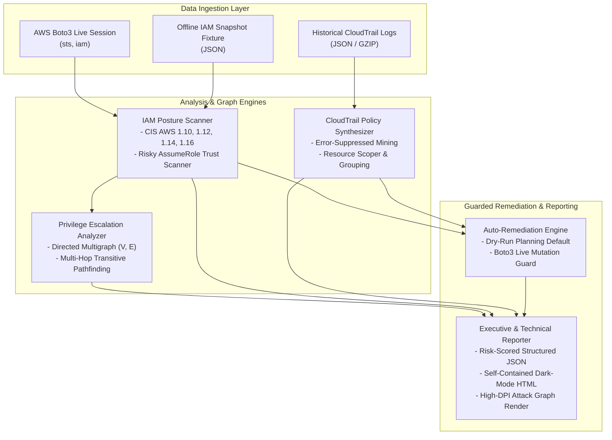
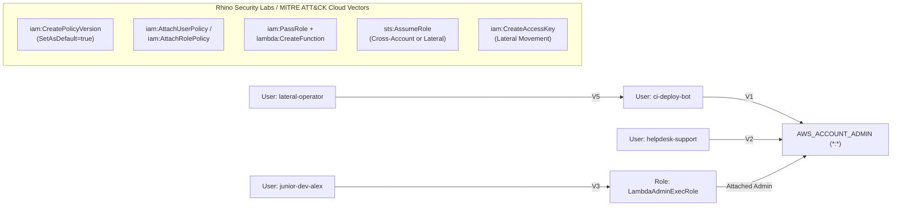
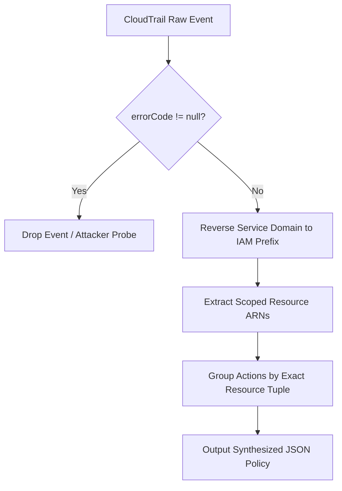

# AWS IAM Auditor & Least-Privilege Synthesizer: Architecture Specification

## 1. Executive Overview & Design Philosophy

The **AWS IAM Auditor** is an enterprise-grade cloud security posture management (CSPM) and automated least-privilege policy generation engine. In modern cloud infrastructures, AWS Identity and Access Management (IAM) configurations represent the primary perimeter. Over-permissive entitlements, stale access keys, unmonitored trust boundaries, and transitive privilege escalation chains frequently convert localized workload compromises into full account takeovers.

This platform enforces a Zero-Trust posture through three coupled subsystems:
1. **Deterministic Static Posture & CIS Benchmark Scanner**: Identifies baseline compliance violations without generating false alarms.
2. **Directed Graph Privilege Escalation Analyzer**: Applies graph theory via `NetworkX` to detect non-obvious multi-hop escalation chains to effective Account Administrator (`*:*`).
3. **CloudTrail Telemetry Synthesizer**: Mines historical AWS CloudTrail API events, filters attacker probes, and synthesizes tightly scoped least-privilege IAM policies.
4. **Guarded Auto-Remediation Subsystem**: Operates behind strict `--dry-run` guarantees, providing deterministic execution planning before any IAM resource mutation.

---

## 2. Mathematical Formalization of Privilege Escalation Graphs

### 2.1 Graph Definition
We define an AWS account's identity infrastructure as a directed graph $G = (V, E)$, where:
- The vertex set $V = V_{\text{users}} \cup V_{\text{roles}} \cup V_{\text{policies}} \cup \{ \text{AWS\_ACCOUNT\_ADMIN} \}$.
- The edge set $E \subseteq V \times V$ represents allowable privilege transitions, permissions grants, trust relationships, or credential generations.

Each directed edge $e = (u, v) \in E$ is labeled with a tuple:
$$\mathcal{L}(e) = \left( \text{vector}, \mathcal{P}_{\text{required}}, \mathcal{C}_{\text{conditions}} \right)$$
where $\mathcal{P}_{\text{required}} \subseteq \text{Actions}$ is the minimal set of AWS IAM actions required to traverse the edge, and $\mathcal{C}_{\text{conditions}}$ represents policy conditions (e.g., `aws:MultiFactorAuthPresent`, `sts:ExternalId`).

### 2.2 Privilege Escalation Vectors Modeled
The analyzer identifies five primary classes of single-hop and multi-hop escalations:

1. **Direct Administrative Policy Version Modification (`CreatePolicyVersion`)**:
   $$u \xrightarrow{\text{iam:CreatePolicyVersion}} \text{AWS\_ACCOUNT\_ADMIN}$$
   *Trigger*: Principal possesses `iam:CreatePolicyVersion` on `*` or on an attached customer-managed policy. By creating a new version with `Action: *` and `Resource: *` and marking `SetAsDefault: true`, the principal gains immediate account admin rights.

2. **Policy Attachment Escalation (`AttachUserPolicy` / `AttachRolePolicy` / `PutUserPolicy`)**:
   $$u \xrightarrow{\text{iam:AttachUserPolicy}} \text{AWS\_ACCOUNT\_ADMIN}$$
   *Trigger*: Principal possesses permission to attach policies or inject inline policies to their own identity or an administrative entity.

3. **Compute PassRole Pivot (`PassRole` + Compute Execution)**:
   $$u \xrightarrow{\text{iam:PassRole} + \text{lambda:CreateFunction}} r_{\text{admin}} \xrightarrow{\text{Execute}} \text{AWS\_ACCOUNT\_ADMIN}$$
   *Pre-requisite Verification*: The analyzer strictly checks that:
   $$\text{Principal.Service} \in \text{TrustPolicy}(r_{\text{admin}}) \quad \lor \quad \text{TrustPolicy}(r_{\text{admin}}) = *$$
   If a role's trust document only permits external AWS accounts (e.g., `arn:aws:iam::111122223333:root`), the pass-role edge is disallowed, eliminating false positives.

4. **Credential Manipulation & Lateral Movement (`CreateAccessKey`)**:
   $$u_{\text{low}} \xrightarrow{\text{iam:CreateAccessKey}} u_{\text{high}} \rightarrow \text{AWS\_ACCOUNT\_ADMIN}$$
   *Trigger*: If an unprivileged user can create access keys for another identity with higher permissions, a lateral privilege leap is established.

5. **Transitive Pathfinding Algorithm**:
   Let $\text{Paths}(u, \text{AWS\_ACCOUNT\_ADMIN}, k)$ denote all simple paths from $u$ to $\text{AWS\_ACCOUNT\_ADMIN}$ with length $\le k$:
   $$\text{Paths}(u, \text{Target}, k) = \{ (v_0, v_1, \dots, v_m) \mid v_0 = u, v_m = \text{Target}, m \le k, v_i \text{ pairwise distinct} \}$$
   For each discovered path, the total required permission vector is the union of step-wise actions:
   $$\mathcal{P}_{\text{composite}} = \bigcup_{i=0}^{m-1} \mathcal{P}_{\text{required}}(v_i, v_{i+1})$$

---

## 3. CIS AWS Foundations Benchmark Compliance Matrix

| CIS ID | Benchmark Title | Implementation Method | Failure Threshold | Severity |
| :--- | :--- | :--- | :--- | :--- |
| **CIS 1.10** | Ensure MFA is enabled for all console users | `IAMAuditScanner.check_users_without_mfa()` | `PasswordEnabled == True` and `len(MFADevices) == 0` | **HIGH** |
| **CIS 1.12** | Ensure credentials unused for 90 days are disabled | `IAMAuditScanner.check_unused_access_keys()` | `Status == Active` and `days_since(LastUsedDate) >= 90` | **HIGH** |
| **CIS 1.14** | Ensure access keys are rotated every 90 days or less | `IAMAuditScanner.check_unused_access_keys()` | `Status == Active` and `days_since(CreateDate) >= 90` and `LastUsed == None` | **HIGH** |
| **CIS 1.16** | Ensure IAM policies with full wildcard administrative privileges are restricted | `IAMAuditScanner.check_wildcard_policies()` | `Effect == Allow` and `Action == *` and `Resource == *` | **CRITICAL** |
| **CIS 1.20** | Ensure support role is used for incident management | `IAMAuditScanner.check_unused_roles()` | `days_since(LastUsedDate) >= 90` | **MEDIUM** |
| **Custom** | Confused Deputy Cross-Account Protection | `IAMAuditScanner.check_risky_trust_policies()` | External account `:root` without `sts:ExternalId` or MFA | **HIGH** |
| **Custom** | Public Wildcard Principal Trust | `IAMAuditScanner.check_risky_trust_policies()` | `"Principal": "*"` in AssumeRole trust statement | **CRITICAL** |

---

## 4. CloudTrail Least-Privilege Synthesis Architecture

### 4.1 Telemetry Poisoning Defense
A critical vulnerability in naive log-based policy generators is **attacker probe poisoning**: when an adversary scans an environment and generates `AccessDenied` events, naive policy generators include those unauthorized calls into synthesized policies. 

The `CloudTrailPolicyGenerator` implements strict error-suppression filtering:
$$\text{Event Accepted} \iff \text{errorCode} = \text{null} \;\land\; \text{errorMessage} = \text{null}$$

### 4.2 Resource ARN Resolution Pipeline
Observed CloudTrail event tuples $(\text{eventSource}, \text{eventName}, \text{requestParameters})$ are translated into normalized IAM actions and resource ARNs:

- **S3 Bucket / Object Scoping**:
  - `bucketName` + `key` or `GetObject`/`PutObject`/`DeleteObject` $\implies$ `arn:aws:s3:::bucket/*`
  - Bucket-level operations (`ListBucket`, `GetBucketPolicy`) $\implies$ `arn:aws:s3:::bucket`
- **DynamoDB Tables**:
  - `tableName` $\implies$ `arn:aws:dynamodb:{region}:{account_id}:table/{tableName}`
- **SQS Queues**:
  - `queueUrl` $\implies$ `arn:aws:sqs:{region}:{account_id}:{queue_name}`
- **Secrets Manager Secrets**:
  - `secretId` $\implies$ `arn:aws:secretsmanager:{region}:{account_id}:secret:{secretId}*`
- **AWS KMS Keys**:
  - `keyId` $\implies$ `arn:aws:kms:{region}:{account_id}:key/{keyId}`
- **Amazon SNS Topics**:
  - `topicArn` $\implies$ Scoped Topic ARN
- **CloudWatch Logs**:
  - `logGroupName` $\implies$ `arn:aws:logs:{region}:{account_id}:log-group:{logGroupName}:*`

---

## 5. Risk Scoring & Posture Grading Algorithm

The account risk score $S \in [0, 100]$ is computed as a weighted sum of findings normalized against an enterprise baseline:

$$\text{Raw Points} = \sum_{f \in \mathcal{F}} W(\text{severity}(f))$$
where:
$$W(\text{CRITICAL}) = 40, \quad W(\text{HIGH}) = 25, \quad W(\text{MEDIUM}) = 12, \quad W(\text{LOW}) = 5$$

The normalized score is bounded:
$$S = \min\left(100, \left\lfloor \frac{\text{Raw Points}}{250} \times 100 \right\rceil \right)$$

**Critical Risk Floor**:
If $\exists f \in \mathcal{F}$ such that $\text{severity}(f) = \text{CRITICAL}$, then:
$$S = \max(S, 75)$$

### Posture Grading Scale
$$\text{Grade}(S) = \begin{cases} 
\text{CRITICAL RISK (Grade: F)} & \text{if } S \ge 80 \\
\text{HIGH RISK (Grade: D)} & \text{if } 60 \le S < 80 \\
\text{MODERATE RISK (Grade: C)} & \text{if } 35 \le S < 60 \\
\text{LOW RISK (Grade: A)} & \text{if } S < 35 
\end{cases}$$

---

## 6. Guarded Auto-Remediation Subsystem

The auto-remediator strictly adheres to a **Safe-By-Default** protocol:

1. **Dry-Run Enforcement**: In default execution mode, no mutable API calls are transmitted to AWS. All proposed mutations (`iam.update_access_key(Status='Inactive')` and `iam.put_role_policy(...)`) are logged into a structured remediation plan.
2. **Explicit Execution Guard**: Live execution requires both `--live-aws` and `--execute-remediation`.
3. **Audit Trail**: Every remediation action records target identifier, exact Boto3 API method, payload, execution timestamp, and status (`DRY_RUN_PLANNED`, `EXECUTED_KEY_DISABLED`, `EXECUTED_POLICY_APPLIED`, or `FAILED_EXECUTION`).
