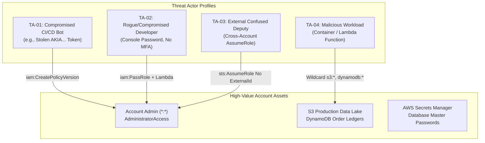
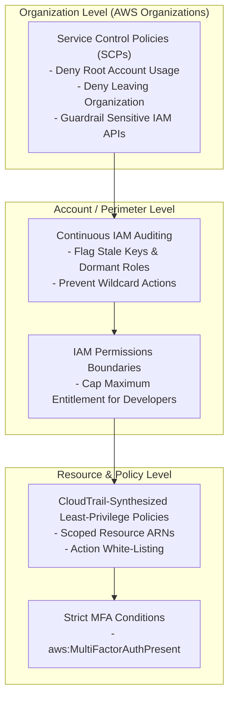

# AWS IAM Threat Model & Privilege Escalation Matrix

## 1. Threat Landscape Overview

In cloud-native environments, identities represent the primary attack surface. Attackers compromising a low-privileged container, serverless function, or developer laptop frequently leverage over-permissive IAM permissions and assume-role chains to execute lateral movement and vertical privilege escalation.

This document models threat actors, trust boundaries, escalation primitives, and MITRE ATT&CK Cloud mappings detected and mitigated by the **AWS IAM Auditor**.

---

## 2. Threat Actor Profiles & Capabilities



| Threat Actor | Initial Access Vector | Objective | Detection Module |
| :--- | :--- | :--- | :--- |
| **TA-01: CI/CD Pipeline Hijacker** | Stale API Access Key extracted from compromised artifact repository | Vertical privilege escalation to Account Admin | `PrivilegeEscalationAnalyzer` (`CreatePolicyVersion`) |
| **TA-02: Credential Stuffing / Phished User** | Password spraying against console user lacking MFA | Administrative takeover and persistence | `IAMAuditScanner` (`check_users_without_mfa`) |
| **TA-03: Confused Deputy Attacker** | Exploitation of 3rd-party SaaS vendor role lacking `ExternalId` | Cross-account lateral movement into VPC resources | `IAMAuditScanner` (`check_risky_trust_policies`) |
| **TA-04: Compromised Serverless Function** | Code execution inside over-privileged Lambda execution environment | Data exfiltration across S3, DynamoDB, SecretsManager | `CloudTrailPolicyGenerator` (Wildcard Policy Replacement) |

---

## 3. MITRE ATT&CK for Cloud (AWS) Mapping

The IAM Auditor's findings map directly to tactics and techniques in the **MITRE ATT&CK for Cloud** framework:

| MITRE ATT&CK Technique | Technique Name | Exploited IAM Primitive | Auditor Detection Finding | Mitigation Strategy |
| :--- | :--- | :--- | :--- | :--- |
| **T1078.004** | Valid Accounts: Cloud Accounts | Stale or unrotated `AKIA...` keys; console accounts without MFA | `KEY-006`, `KEY-007`, `MFA-008`, `MFA-009` | Auto-deactivation of unused keys (`Status=Inactive`); enforce MFA conditions |
| **T1098.001** | Account Manipulation: Additional Cloud Credentials | `iam:CreateAccessKey` on unmonitored user identities | `ESC-001` (Lateral AccessKey generation) | Scope `iam:CreateAccessKey` with `Resource` ARN restrictions |
| **T1098.003** | Account Manipulation: Additional Cloud Roles | `iam:CreatePolicyVersion`, `iam:SetDefaultPolicyVersion` | `ESC-001` (CreatePolicyVersion path) | Apply Permissions Boundaries; monitor policy version creation events |
| **T1548.002** | Abuse Elevation Control Mechanism: PassRole Abuse | `iam:PassRole` combined with `lambda:CreateFunction` | `ESC-002` (PassRole + Lambda path) | Restrict `iam:PassRole` `Resource` to explicit non-admin role ARNs |
| **T1484.001** | Domain Policy Modification: IAM Policy Modification | `iam:AttachUserPolicy`, `iam:PutUserPolicy` | `ESC-004` (AttachUserPolicy path) | Restrict administrative policy attachments via Service Control Policies (SCPs) |
| **T1199** | Trusted Relationship | Unconstrained `sts:AssumeRole` without `sts:ExternalId` | `TRS-010`, `TRS-011` (Risky Trust Policies) | Require `sts:ExternalId` and explicit trusted account/role ARNs |

---

## 4. Privilege Escalation Attack Trees (Rhino Security Labs Primitives)

### Path 1: `iam:CreatePolicyVersion` Direct Escalation
```
[User: ci-deploy-bot]
       │
       ▼ (Possesses iam:CreatePolicyVersion on *)
[Creates New Policy Version v2]
       │
       ▼ (Statement: Effect=Allow, Action=*, Resource=*, SetAsDefault=true)
[AWS_ACCOUNT_ADMIN (*:*)]
```
- **Prerequisites**: `iam:CreatePolicyVersion` allowed on customer-managed policies attached to the identity.
- **Auditor Mitigation**: Apply SCP denying `iam:CreatePolicyVersion` outside SecOps and remove wildcard resource grants.

### Path 2: `iam:PassRole` + `lambda:CreateFunction` Multi-Hop Escalation
```
[User: junior-dev-alex] (Missing MFA)
       │
       ▼ (Calls lambda:CreateFunction + passes LambdaAdminExecRole)
[AWS Lambda Service: attacker-escalation-func]
       │
       ▼ (Lambda service executes with Role: LambdaAdminExecRole)
[Role: LambdaAdminExecRole] (Has Attached AdministratorAccess)
       │
       ▼ (Lambda invokes sts:AssumeRole or creates admin access keys)
[AWS_ACCOUNT_ADMIN (*:*)]
```
- **Prerequisites**: `iam:PassRole` on role trusted by `lambda.amazonaws.com`, plus `lambda:CreateFunction` and `lambda:InvokeFunction`.
- **Auditor Mitigation**: Add permissions boundary on `junior-dev-alex` and restrict `iam:PassRole` to low-privilege roles only.

### Path 3: Confused Deputy Trust Exploitation
```
[External Attacker in AWS Account 111122223333]
       │
       ▼ (Calls sts:AssumeRole on target role)
[Role: LegacyVendorCrossAccountRole] (In Target Account 998877665544)
       │ (Trust Document: "Principal": {"AWS": "arn:aws:iam::111122223333:root"}, No Condition)
       ▼ (Inline Policy: VendorFullS3AndIAM - grants s3:*, iam:*)
[Target Account IAM & S3 Control]
```
- **Prerequisites**: Role trust policy trusts external account without `sts:ExternalId` or MFA conditions.
- **Auditor Mitigation**: Inject condition requiring cryptographically random UUID in `sts:ExternalId` shared out-of-band with the authorized vendor.

---

## 5. Defense-In-Depth Architecture


